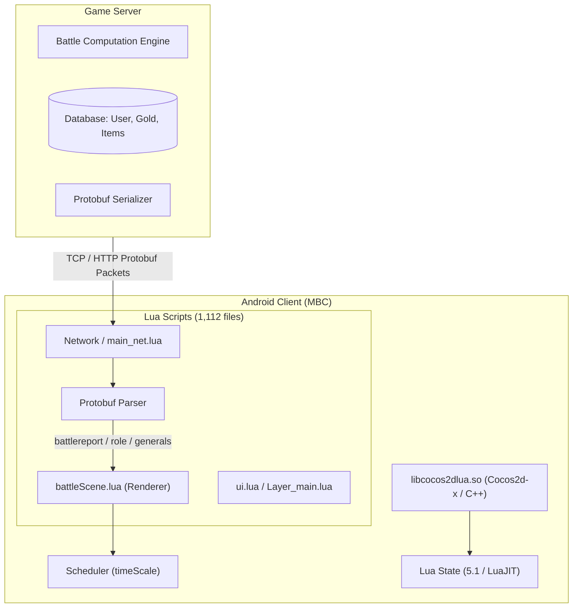

# Kiến trúc Hệ thống Game: Manga Bá Cháy (`mbc`)

## 1. Mô hình Tổng thể

Manga Bá Cháy (`mbc`) sử dụng kiến trúc **Client-Server lai (Hybrid Turn-based Card RPG)** được xây dựng trên nền tảng Cocos2d-x v2/v3 tùy biến (Lua binding).

---

## 2. Các Thành phần Kỹ thuật Cốt lõi

### 2.1. Cơ chế Tải và Bảo vệ Script (`goddess_lua_loader`)
Game không dùng loader mặc định của Cocos2d-x mà cài đặt một loader tùy biến mang tên `goddess_lua_loader` trong `libcocos2dlua.so`:
- Khi game yêu cầu tải module Lua (ví dụ `require("battleScene")`):
  1. Loader kiểm tra tệp tin tương ứng trong thư mục `assets/scripts/`, `assets/common_lua/`, `assets/pb/`.
  2. Các tệp tin được đặt phần mở rộng giả dạng `.so` (ví dụ `battleScene.so`, `functions.so`).
  3. Loader đọc dữ liệu nhị phân và gọi hàm giải mã `xxtea_decrypt` với khóa 16 bytes: `3c883f7813a3ee68`.
  4. Thuật toán XXTEA sử dụng tham số `inc_len = 1`, trong đó 4 byte cuối của chuỗi sau giải mã chỉ định kích thước chính xác của văn bản gốc.
  5. Sau khi giải mã, văn bản là mã nguồn Lua plain-text hoàn chỉnh, được chuyển vào `luaL_loadbuffer` để thực thi.

### 2.2. Cơ chế Chiến đấu (Battle Mechanics)
- **Hoàn toàn tính toán trên Server (Server-Side Calculation):**
  - Khi bắt đầu trận chiến (Vượt ải, Đấu trường, Leo tháp), client gửi gói tin `copyattack_pb` hoặc `athleticsattack_pb`.
  - Server thực hiện toàn bộ thuật toán tính lượt đánh, ra chiêu, bạo kích, né tránh, sát thương và sinh ra gói tin `battlereport_pb` cùng `battleresult_pb`.
  - Client nhận `battlereport` và chuyển đổi thành danh sách hành động hoạt ảnh qua hàm `convertBattleReportToAnimationSub`.
- **Vai trò của Client trong trận chiến:**
  - Client chỉ đơn thuần là một bộ diễn hoạt (Playback Renderer).
  - Khung hình diễn hoạt chịu sự chi phối trực tiếp của biến `timeScale` trong `CCDirector::getScheduler()`.
  - Khi người chơi ấn nút "Bỏ qua" (`tiaoguo` / `endButton`), hàm `battleScene.endfunction(self)` sẽ hủy toàn bộ action chuỗi hoạt họa và hiển thị thẳng màn hình kết quả `showResult()`.

### 2.3. Quản lý Tài nguyên & Tiền tệ
- Dữ liệu tiền tệ (`ROLE_COIN`, `ROLE_GOLD`), thể lực (`ROLE_STAMINA`), hoạt lực (`ROLE_ENERGY`) được đồng bộ qua `role_pb`.
- Mọi giao dịch nâng cấp trang bị, bồi dưỡng tướng, mua sắm cửa hàng đều gửi request lên Server xác thực trước khi cập nhật số dư.
- Do đó:
  - Sửa đổi số dư Kim Cương / Vàng trong bộ nhớ client chỉ có tác dụng thị giác (Visual), khi mua sắm sẽ bị Server từ chối (`error_pb`).
  - Các giá trị thuộc về Client Logic (như Tốc độ hiển thị, Mở khóa nút Skip, Bỏ qua thời gian chờ, Tắt kiểm tra VIP cho nút x3 tốc độ) có thể can thiệp 100% bằng GameGuardian.
