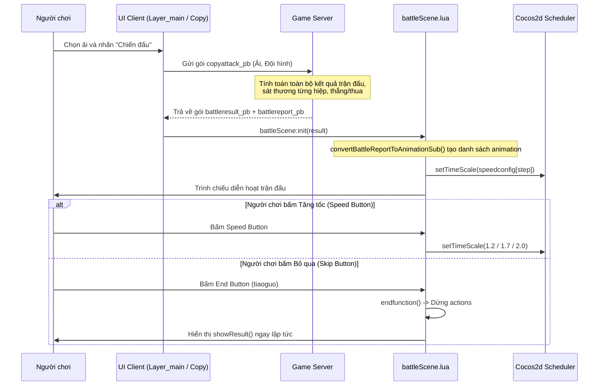

# Luồng Dữ liệu Trận đấu & Hệ thống (Data Flow): Manga Bá Cháy (`mbc`)

## 1. Luồng Khởi tạo và Thực thi Trận đấu

---

## 2. Luồng Đồng bộ Chỉ số Nhân vật & Tướng

1. **Khởi động & Đăng nhập:**
   - Client gửi `userchannellogin_pb`.
   - Server phản hồi `responseuser_pb`, nạp toàn bộ cấu trúc `Role` và `Generals` vào bộ nhớ client (đối tượng toàn cục `GameScene.roleinfo` và `GameScene.generals`).
2. **Cập nhật Chỉ số khi Nâng cấp:**
   - Người chơi bấm nâng cấp trang bị / cường hóa tướng:
   - Client gửi `equipstrengthen_pb` hoặc `inheritrequest_pb`.
   - Server tính toán, trừ tiền trên Database, trả về `result_pb`.
   - Client nhận phản hồi và cập nhật lại `roleinfo.coin` và chỉ số `general.atk`, `general.hp`.
